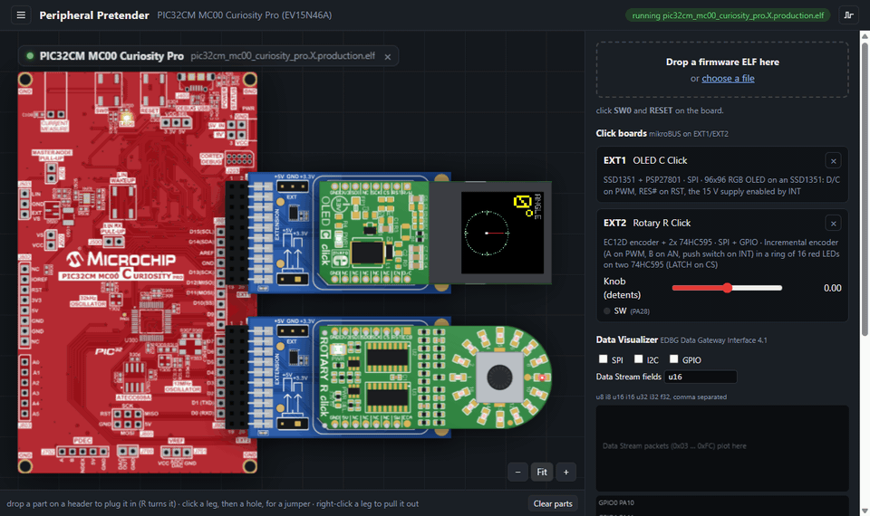
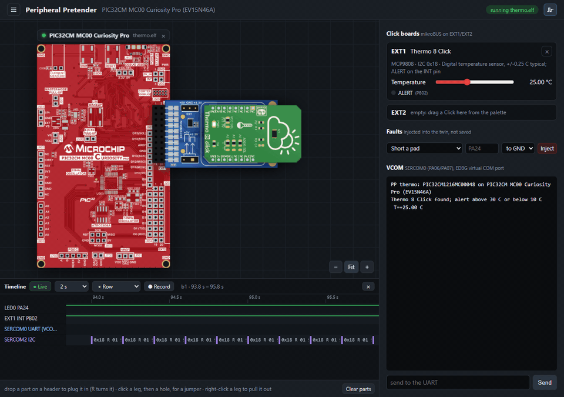
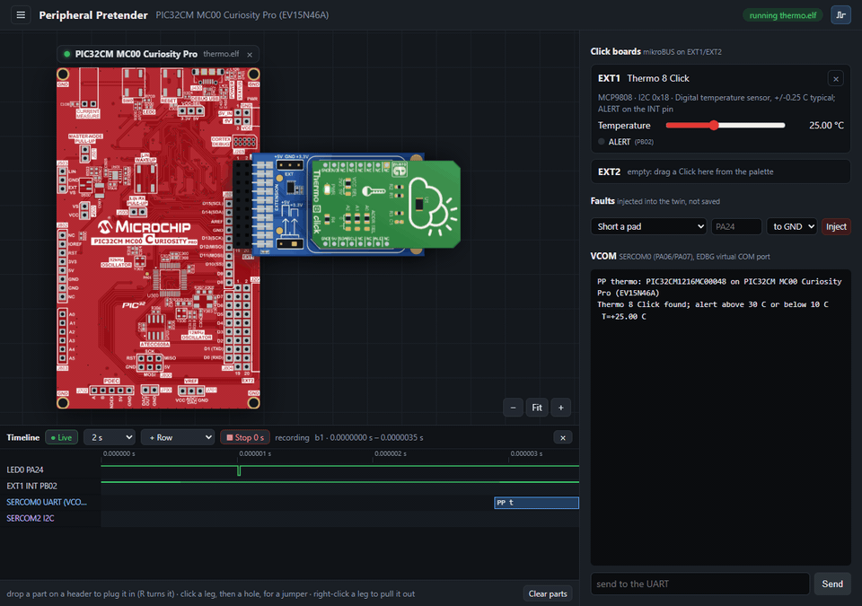
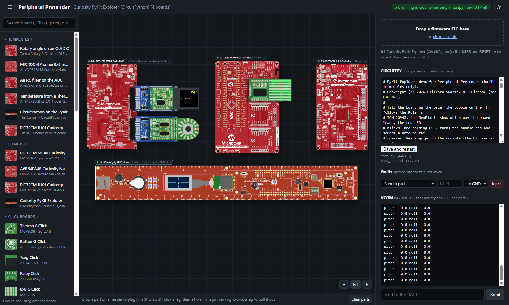
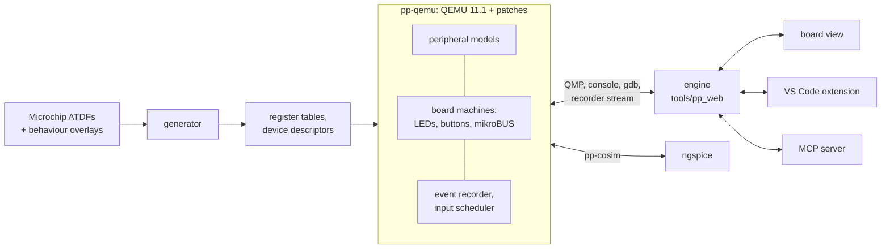

<div align="center">

# Peripheral Pretender

**Microchip dev boards that run your firmware, without the board.**

A QEMU digital twin of PIC32CM, SAM E51 and AVR boards and 38 MikroE Click boards, checked
against silicon. A live board view, a logic-analyzer timeline, fault injection and exact replay,
in VS Code, in CI, or driven by an AI assistant over MCP.




<sub>An MPLAB X project (Microchip's Harmony start-up code and a new <code>main.c</code>) on a PIC32CM MC00
Curiosity Pro twin. Turning the Rotary R Click's knob pulses its encoder into the EIC; the firmware
redraws the angle on the OLED C Click over SPI and points the knob's LED ring the same way through
two shift registers on the same bus. (Real time.)</sub>

</div>

## What it does

- **Runs your firmware unchanged.** The ELF you would program into the board (MPLAB X, MPLAB for
  VS Code, XC32, arm-none-eabi-gcc, XC8, avr-gcc, or stock CircuitPython) boots on QEMU models
  of the chip. Peripherals are probed on real boards, and the twin has to match the silicon
  transcripts byte for byte.
- **Shows the real board.** Rendered from Microchip's production Gerbers: LEDs follow the pins
  (PWM dims them), buttons click, the virtual COM port is a console.
- **Click boards.** 38 MikroE Clicks (OLEDs, a character LCD, sensors, ADCs and DACs, I/O
  expanders, rotary encoders, LED matrices, motors, radios…) plug into mikroBUS headers, or
  wire pin by pin to any pads; the bench checks that a SERCOM can reach them.
- **A logic analyzer on every pin.** Pad edges, UART bytes, SPI transfers, I2C transactions and
  interrupts, stamped with the firmware's own time, in a timeline that zooms from a minute down
  to microseconds.
- **Breaks things on purpose.** Short a pin to GND, make an I2C device stop answering, stick
  MISO, and watch how your error handling copes.
- **Exact replay.** Record a run with its button presses, knob turns and console input, replay it
  event for event, and get told where a replay first differs.
- **Analog in the loop.** SPICE circuits run in ngspice in lockstep with the chip: an RC on an
  ADC pin charges the way it would on the bench.
- **Debugging.** F5 in VS Code: breakpoints and stepping on the twin through gdb, with each new
  MPLAB build picked up as it lands.
- **An assistant can drive.** An MCP server gives AI assistants the bench: add boards, plug
  Clicks, run firmware, press buttons, read the console and the timeline, inject faults, record
  and replay.

## The timeline and fault injection



<sub>A Thermo 8 Click (MCP9808) on I2C. Warming it past 30 °C trips its ALERT line and the firmware
reports it. Then the sensor is made to stop answering: every read on SERCOM2 turns into a red
`0x18 W NACK` on the timeline, the board's title shows ⚡ 1 fault, and the console goes quiet.
Removing the fault brings the readings back. (Real time.)</sub>

The timeline is a drawer under the bench. Rows come from the board (its LEDs, buttons and Click
pins) and from what happened (each bus that talked, the interrupts taken). Hover a transfer for
its bytes; the wheel zooms onto whatever is under the cursor.

| Fault | What the firmware sees |
|---|---|
| short (pad, GND or VDD) | the pad reads that level over every driver, its own output too |
| I2C not answering (address, or a Click) | that address NACKs before any device sees the start |
| MISO stuck (SPI host, value) | the host reads that value whatever the device sends |

## Exact replay



<sub>Record restarts the firmware from reset and keeps every input with the instant it took
effect. Replay runs it again and compares a hash of everything that happened, 10 ms at a time:
here all 684 events matched. (Real time.)</sub>

Under `-icount` the twin's clock is the firmware's own instruction count, so a run can repeat
exactly: the event recorder in QEMU applies each input at its recorded virtual instant, and
paces the run to real time by pausing the VM, which the guest can't notice. A replay that
differs names the first 10 ms where it parted, which turns a flaky bug into a reproducible one.

## Boards



<sub>Four boards on one bench, each running its own firmware. The palette on the left holds templates,
boards, Click boards and parts; the side panel follows the selected board (here the PyKit, with
its CircuitPython `code.py`).</sub>

| Board | MCU | Core | QEMU machine |
|---|---|---|---|
| PIC32CM MC00 Curiosity Pro (EV15N46A) | PIC32CM1216MC00048 | Cortex-M0+ | `pic32cm-mc00-cpro` |
| PIC32CM JH01 Curiosity Pro (EV81X90A) | PIC32CM5164JH01100 | Cortex-M0+ | `pic32cm-jh01-cpro` |
| AVR64EA48 Curiosity Nano (EV66E56A), on a Curiosity Nano Base | AVR64EA48 | AVRxt | `avr64ea48-cnano` |
| Curiosity CircuitPython (Curiosity PyKit Explorer) | ATSAME51J20A | Cortex-M4F | `curiosity-circuitpython` |

On the MC00, each of these was checked against the board on the desk: PORT, SERCOM (UART, and
SPI and I2C host), EIC, EVSYS, TC, TCC (with faults, capture and circular buffers), RTC, ADC,
SDADC, DAC, AC, TSENS, FREQM, DMAC, WDT, NVMCTRL, CCL, PDEC, the clock tree, and sleep and
standby.

## Quick start

**Just run it** (Windows x64): install the VS Code extension from
[Releases](https://github.com/Clifford-Swartz/peripheral-pretender/releases/latest). It carries
QEMU, Python and gdb, so there is nothing else to install.

```
code --install-extension peripheral-pretender-win32-x64-<version>.vsix
```

Reload VS Code and click the chip icon in the activity bar. The bench opens with templates: pick
one, or drop your own `.elf` on a board. [`vscode/README.md`](vscode/README.md) has the rest.

**Build it yourself:** [`SETUP.md`](SETUP.md) goes step by step, each step with a check, and is
written for AI coding agents as much as for people. In short:

```
python scripts/fetch_packs.py      # the device packs
qemu/setup.sh                      # the QEMU fork, patched and built
py -m tools.pp_web --board ev15n46a --elf firmware/hello/build/pic32cm_mc00_cpro/blinky.elf
```

**Let an assistant drive:** the extension registers its MCP server with VS Code. For Claude
Code: `claude mcp add pp -e PYTHONPATH=<repo> -- py -m tools.pp_mcp`. Then ask, for example,
"put a Thermo 8 on EXT1 of the MC00, run thermo.elf, warm it to 35 °C and show me the I2C
traffic when the alert fires". The bench tools: `bench_status`, `bench_add_board`,
`bench_remove_board`, `bench_template`, `bench_plug`, `bench_run`, `bench_press`,
`bench_control`, `bench_uart`,
`bench_timeline`, `bench_faults`, `bench_record`, `bench_replay`, `bench_recordings`.

## How it works



- **Generated, not hand-typed.** Register maps come from Microchip's ATDF files through a
  generator, with per-IP overlays for the behaviour an ATDF can't express.
- **Silicon is the referee.** Probe firmware runs on a real board and on the twin, and the
  transcripts in `golden/` must match. Where silicon and the data sheet disagree, silicon wins
  and the difference is written down.
- **Deterministic on demand.** The event recorder streams every pad, bus and interrupt event in
  virtual time, and schedules inputs at virtual instants for exact replay.
- **Headless first.** The engine is a plain process with HTTP and WebSocket APIs. The board view,
  the VS Code extension and the MCP server are all clients of it, so CI can do anything the IDE
  can.

More: [`docs/handoff.md`](docs/handoff.md) (status and next steps),
[`docs/design/`](docs/design) (timeline and replay, the workspace, analog co-simulation),
[`playbooks/`](playbooks) (adding a board or a Click board).

## Layout

| Path | What |
|---|---|
| `qemu/` | the pp-qemu fork, as patches on QEMU v11.1.2, and `setup.sh` to build it |
| `generator/`, `overlays/`, `profiles/`, `devices/` | from ATDFs to register tables and device descriptions |
| `tools/pp_web/` | the engine and the board view |
| `tools/pp_mcp/` | the MCP server: the runner and the live bench |
| `tools/pp/` | the `pp` command-line runner and the recorder's decoders |
| `tools/pp_analog/` | analog co-simulation with ngspice |
| `vscode/` | the VS Code extension |
| `firmware/` | test firmware that runs unchanged on the twin and on silicon |
| `golden/`, `harness/` | silicon transcripts and the comparison harness |
| `examples/` | MPLAB projects that run on the twin |
| `tests/` | the pytest suites |

The QEMU fork is built next to this repository (`../pp-qemu`), because QEMU's configure script
rejects paths that contain spaces.

## Fine print

A personal side project by Clifford Swartz, not affiliated with or endorsed by Microchip
Technology Inc. or MikroElektronika, and built with heavy AI assistance. Board pictures are
rendered from Microchip's published design files.

MIT License (see [`LICENSE`](LICENSE)). The QEMU fork's patches in `qemu/patches/` are
GPL-2.0-or-later, like QEMU, and are not for submission upstream.
